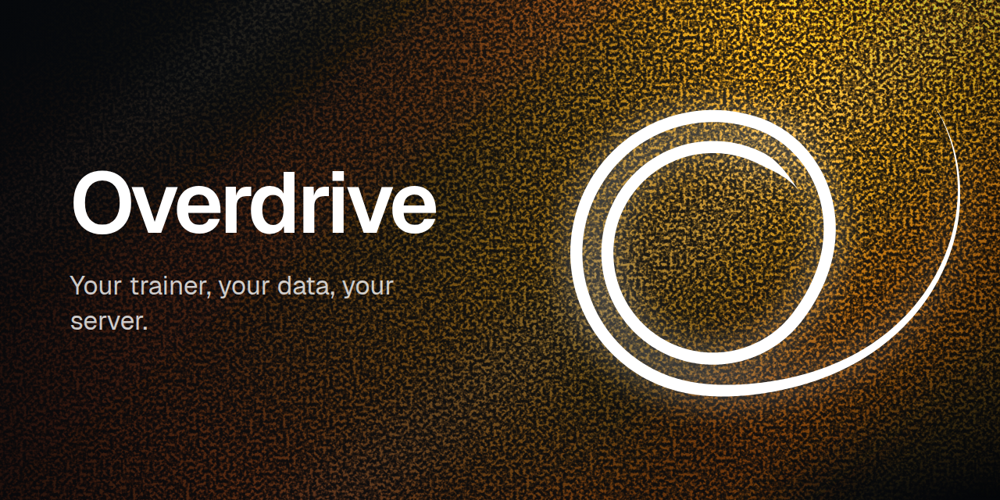

# Overdrive



Single-user indoor cycling system: an Android tablet app that controls a Van Rysel D500 and shows
ride data in an overlay on top of other apps, a thin self-hosted web service with an MCP server so
an AI agent can plan workouts, and a phone companion for statistics and wellness data.

The product and technical spec is [docs/spec.md](docs/spec.md). Start with its §1 (goals, phases)
and §3 (architecture).

## Repository map

| Path | What it is | Stack |
|---|---|---|
| [`core/`](core) | Shared pure-Kotlin core: protocol codecs, ride engine, workout model and player, FIT writer. No Android imports. | Kotlin Multiplatform (JVM) |
| [`android/`](android) | Ride app (tablet), companion app (phone), BLE, local data, design-system components | Kotlin, Jetpack Compose |
| [`server/`](server) | Web service: sync API, MCP server, scheduler, integrations, Telegram bot, insights | TypeScript, Node 24, Fastify |
| [`contracts/`](contracts) | Wire formats shared by every component: JSON Schemas and golden fixtures | JSON Schema |
| [`design/`](design) | Design system and mock-up deliverables | |
| [`docs/`](docs) | Spec snapshot, architecture, decision records | |

Why it is laid out this way: [ADR 0001](docs/adr/0001-repository-layout-and-toolchain.md).

## Getting started

Prerequisites: Node 24 with corepack (`corepack enable`), JDK 17 or newer. Building the Android apps
also needs the Android SDK (`ANDROID_HOME` or `android/local.properties` with `sdk.dir`).

```bash
make setup           # pnpm install
make check           # TypeScript + Kotlin core: lint, typecheck, test, build
make android-check   # Android apps: tests, lint, debug APKs (needs the Android SDK)
make help            # all targets
```

Run the web service locally:

```bash
make server-dev      # http://127.0.0.1:8080/healthz
```

Self-hosted deployment is `docker compose up -d --build` (see [`compose.yaml`](compose.yaml) and
[`.env.example`](.env.example)).
The runbook for the owner's host (Caddy, tokens, backups, updates) is [`docs/deploy.md`](docs/deploy.md).

## Status

**Phase 1 (Android ride app MVP) is built and waiting for the bench.** All four stages are done (see
[`docs/roadmap.md`](docs/roadmap.md)): the design system and the overlay, the ride engine and workouts with crash recovery and
FIT export, the Bluetooth layer for the trainer and the heart-rate strap, and the Zwift Click with the gesture layer, *Learn
buttons*, the developer settings and the sync outbox. Everything a JVM can prove is proved and green in CI; **nothing has run on
the tablet, the bike or a real Click yet.** The owner's bench is next: [`docs/bench-checklist.md`](docs/bench-checklist.md) is the
one ordered list to run, and [`docs/phase1-acceptance.md`](docs/phase1-acceptance.md) says what is automatic and what the bench
confirms. Phase 2 (web service, planned workouts, upload) starts after it.
